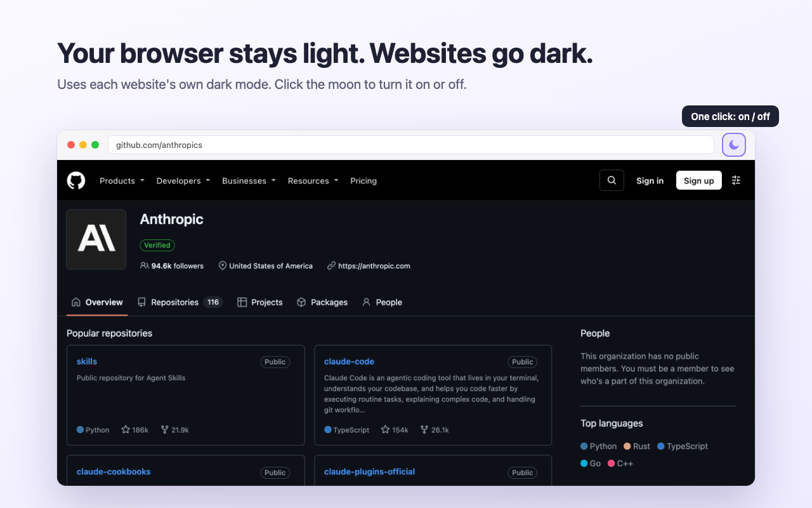

# Site Dark Mode

Your browser stays light. Websites show their own dark mode.

- If a website has a dark mode, the extension shows it.
- If a website has no dark mode, the extension does not change it. It does not make generated dark colors.
- Click the toolbar icon to turn it on or off. A moon means "on". A sun means "off".

I made it for [Dia](https://www.diabrowser.com/), because I like the Dia tabs and sidebar in light mode
but I want websites in dark mode. It works in all Chromium browsers: Dia, Chrome, Arc, Brave, and Edge.

> Site Dark Mode is not made by, or connected with, The Browser Company or Google.

## Install

**From the Chrome Web Store:** coming soon.

**From this repository:**

1. Download this repository (**Code** → **Download ZIP**) and unzip it.
2. Open the extensions page of your browser: `dia://extensions` or `chrome://extensions`.
3. Turn on **Developer mode**.
4. Click **Load unpacked** and select the unzipped folder.
5. Pin the extension to the toolbar, so that you can click the icon.

## How it works

The browser tells each website "the user prefers light" or "the user prefers dark"
with the `prefers-color-scheme` setting. The extension changes "light" to "dark" in three places:

| File | What it does |
|------|--------------|
| `content.js` | Turns on the dark CSS rules of the site and turns off the light rules. It downloads style sheets from other domains through `background.js`. |
| `page-world.js` | Makes `window.matchMedia("(prefers-color-scheme: dark)")` return "yes" for site JavaScript. |
| `rules.json` | Sends the `Sec-CH-Prefers-Color-Scheme: "dark"` header, for sites that choose the theme on the server (for example Google Search). |
| `background.js` | Keeps the on/off state, changes the icon, and turns the other parts on or off. |

There is no build step and there are no dependencies. The files in this folder are the extension.

## Known limits

- Some sites keep dark mode only behind their own button or account setting. The extension cannot find that button.
- Sites that choose the theme with JavaScript one time at page load change only after you reload the page.
- Some pages can show a short white flash before the dark styles start.
- The first click after some time without use can be a little slow, because the browser must wake up the extension.

## Privacy

The extension collects no data and has no server. Read the full [privacy policy](PRIVACY.md).

## License

[MIT](LICENSE)
